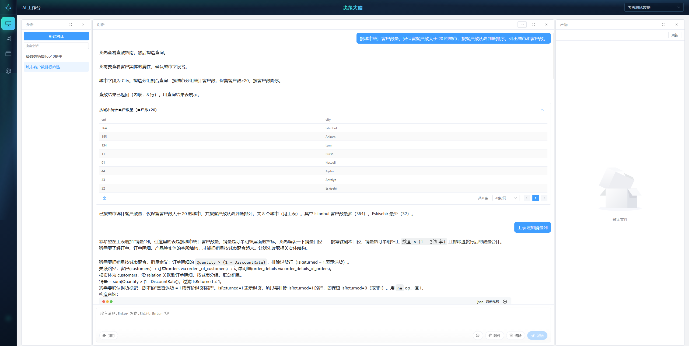
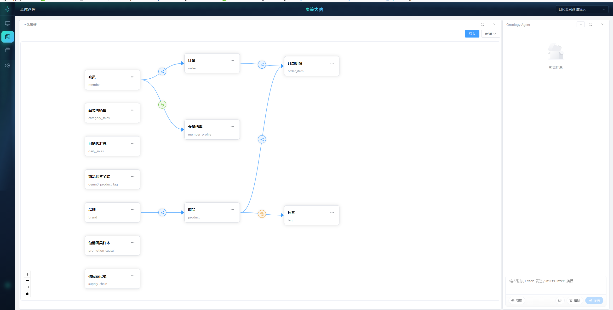
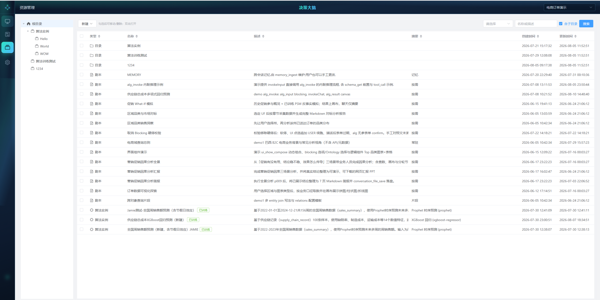
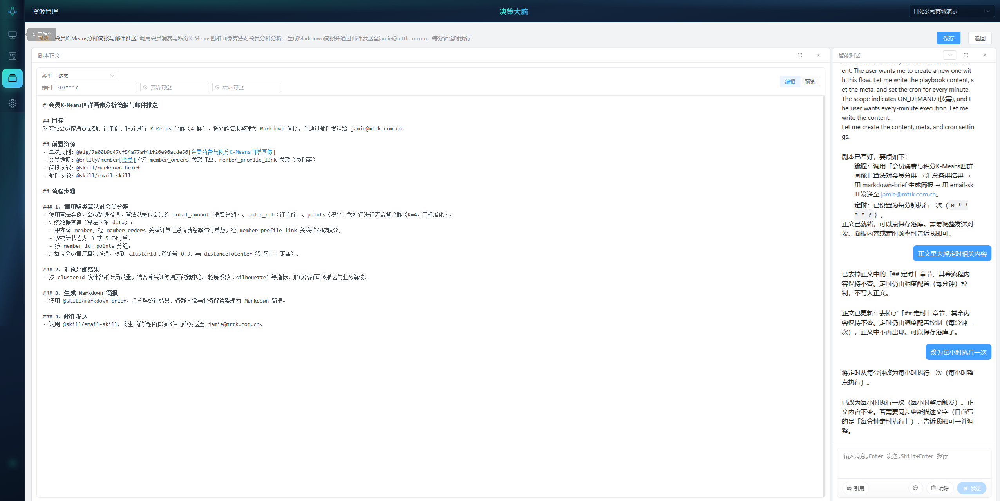

# OpenOntology

面向业务决策的本体与 AI 工作台：把领域知识、数据资源与大模型能力连在一起，让查询、编排与执行可治理、可落地。

## 产品亮点

- **本体驱动**：以域（Domain）组织实体、属性与关系，支撑可复用的业务语义模型
- **AI 工作台**：内嵌对话与工具调用，结合技能（Skills）完成查询、编排与辅助决策
- **资源一体管理**：Playbook、工具、算法、界面组件等统一在资源浏览器中维护
- **开箱即用**：发行包内置 H2，配置 `JAVA_HOME` 后即可启动；亦可切换 MySQL
- **可扩展运行时**：Addon / 本地库 / 可移植依赖分层放置，便于按环境裁剪

## 截图









更多界面见 `docs/images/`（技能、算法、UI 组件等）。

## 产品介绍

OpenOntology（界面品牌名：**决策大脑**）帮助团队用统一的本体描述业务世界，并在同一平台上：

- 维护多域本体与绑定数据
- 通过 Agent 对话调用工具与技能，完成查询与任务编排
- 管理 Playbook、算法与 UI 组件，把能力沉淀为可复用资产

适合需要「业务语义 + AI 执行」一体化的内部平台或产品原型场景。

## 安装

**环境要求**：JDK **25+**，并设置 `JAVA_HOME`。

**快速启动（Windows）**：

```bat
bin\startup.bat
```

浏览器访问：`http://localhost:8825/`

完整步骤（目录说明、停机、MySQL 切换、常见问题）见：

- [安装手册](docs/install.md)

Linux / macOS 可使用 `bin/startup.sh`（同样需 JDK 25+）。

## License

本发行包基于 [Apache License 2.0](LICENSE) 发布。

你可以自由使用、修改与再分发，但须遵守 Apache-2.0 的署名与声明要求；软件按「原样」提供，不附带任何明示或默示担保。
