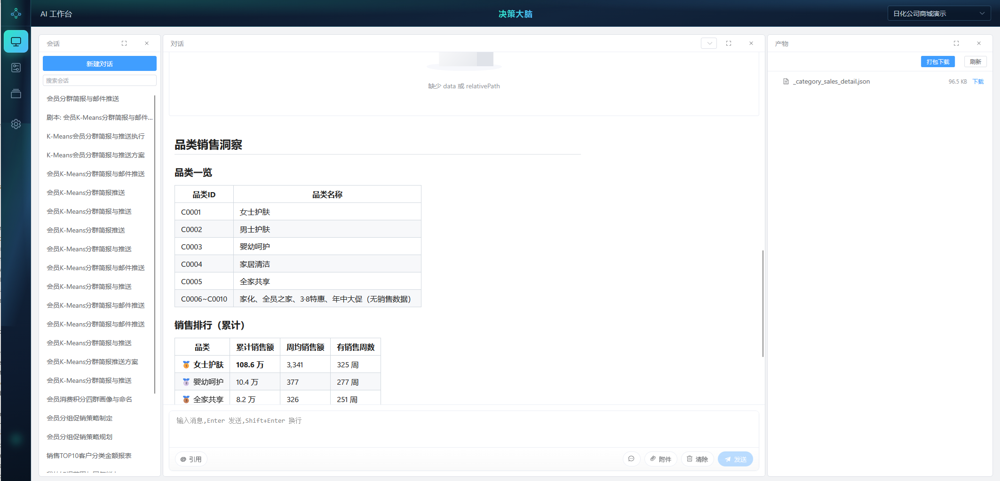
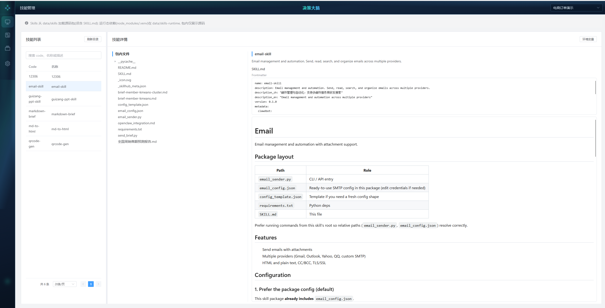
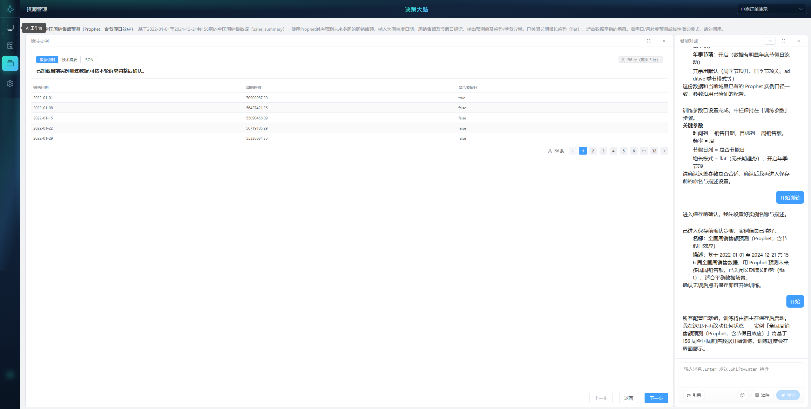
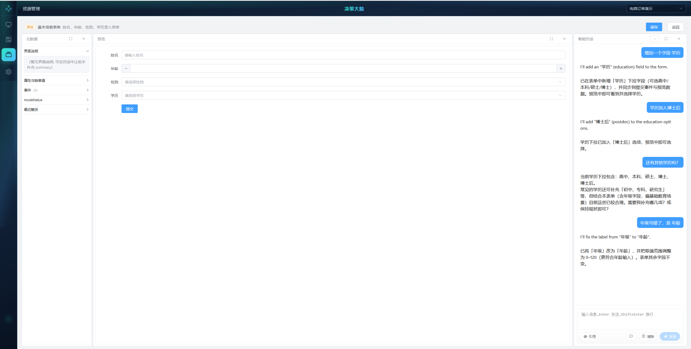

# OpenOntology 决策大脑

企业里真正难的往往不是「有没有数据」，而是如何快速问清问题、看清结果、再往前走一步分析。  
和常规 BI、固定报表不同，OpenOntology定位为**交互式数据探索**：不需要写代码，用业务语言直接询问、发现规律与价值；在图形化界面中完成操作，用图表把结论讲清楚；需要更深入时，再把算法接进来做统计、预测等进阶分析。

## 你可以做什么

- 用业务语言提问，例如：「哪些客户卖的比较好，为什么？」——无需编程或数据开发背景  
- 在对话里用表单补条件、用图表看结果，把「问清楚」和「看明白」连在一起  
- 需要时直接在探索过程中调用算法做训练或推理，验证想法而不另开一套分析工具  
- 本体、资源、剧本与技能既可以在传统界面里维护，也可以通过智能体方式完成，两种方式互通  
- 用剧本固化常用分析路径或域内规则，减少每次从零开始聊  

## 产品亮点

- **本体查询语言**  
  你用业务语言提问，平台把意图落成可执行的结构化查询（Ontology Query Language / JSON），按已知业务模型解释执行。不依赖你具备技术背景，也降低自由生成查询时的幻觉与不可控，结果更可审计。

- **界面和智能体融合**  
  解决的是**对话过程里的输入与展现**：表单、面板、图表进到智能体流程中，条件不必全靠打字，结果不必挤在 Markdown 里。该点选的点选，该看图的看图。

- **算法训练和推理融合**  
  查数、看图之后还能接着算。算法库嵌在智能体链路里，训练与推理可走同一条探索路径，把「发现问题」推进到「验证假设、给出量化结论」。

- **常规软件界面探索**  
  既保留传统软件的精确与高效（结构清晰、操作确定、改完即得），又具备智能体的灵活探索与编排；两条路径互通——界面里维护的资产可被对话调用，智能体侧的调整也能回到管理界面继续治理。不是旁边挂个聊天窗，而是同一套能力上的两种用法。

- **剧本**  
  把常用分析方法、处置步骤，甚至域内规则（如域常驻剧本）写成可编排的剧本。有章法、可复用，也保留组合与演进的可玩空间。

- **扩展性**  
  用技能与工具按业务接外部系统或专用能力，扩展智能体边界，无需改平台内核。

- **多智能体，而非单一超级助手**  
  智能体是解决问题的通用范式：本系统按场景提供多个智能体（探索、本体、资源、剧本、算法等），各自解决一类问题，而不是把一切塞进一个「万能 Agent 平台」。底层有可复用的智能体基础架构（`agent_core`，计划独立开源），业务侧（`impl` + 前端）则给出一套前后端一体的智能体落地范式，便于按问题继续扩展新的智能体。

## 截图

| 界面 | 对应能力 |
|---|---|
| 智能体工作台 / 对话 | 交互式探索；界面和智能体融合 |
| 本体管理 | 业务模型治理；支撑本体查询语言 |
| 资源管理 | 常规软件界面中的资产维护 |
| 剧本 | 路径与规则沉淀 |
| 技能 / 算法库 / 界面组件 | 扩展性；算法训练和推理融合 |

<table>
  <tr>
    <td align="center"> 智能体工作台 · 交互式探索</td>
    <td align="center"> 智能体对话 · 表单与图表融合</td>
  </tr>
  <tr>
    <td align="center"> 本体管理 · 业务模型</td>
    <td align="center"> 资源管理 · 资产治理</td>
  </tr>
  <tr>
    <td align="center"> 剧本 · 路径与规则</td>
    <td align="center"> 技能管理 · 扩展能力</td>
  </tr>
  <tr>
    <td align="center"> 算法库 · 训练与推理</td>
    <td align="center"> 界面组件 · 图形化呈现</td>
  </tr>
</table>

## 快速开始

想尽快跑起来见 **[快速开始](docs/quickstart.md)**。完整手册见 [安装手册](docs/install.md)。

[更多信息，访问今日头条](docs/images/toutiao.png)

## Skills

本项目的能力也可打包成 **Skill**，供 Claude Code、Cursor 等外部智能体平台调用：在外部对话里查本体数据、推进剧本、调用逻辑组件等，而不必进入本系统的图形界面。

发行包内技能目录：[`docs/skills/`](docs/skills/)（当前提供 [`openOntology`](docs/skills/openOntology/SKILL.md)）。

使用前请先完成本系统启动与初始化；将技能目录安装到目标平台后，按该 `SKILL.md` 中的约定调用 HTTP 工具入口。安装步骤见 [安装手册 · Skills](docs/install.md#8-skills外部平台)。

## 下一步开发方向

- **子任务卡**  
  在 AI 对话中以子任务卡片发起并运行 sub agent：把复杂探索拆成可跟踪的子任务，主对话编排、子智能体执行，进度与结果回到当前会话。

- **权限**  
  补齐功能权限与数据权限：按角色控制能用哪些能力、能看哪些域与数据，使多用户协作时边界清晰、可审计。

## License

本发行包基于 [Apache License 2.0](LICENSE) 发布。

你可以自由使用、修改与再分发，但须遵守 Apache-2.0 的署名与声明要求；软件按「原样」提供，不附带任何明示或默示担保。

**Copyright © 2026 旻天信息科技(上海)有限公司**

| | |
|---|---|
| 公司 | 旻天信息科技(上海)有限公司 |
| 联系人 | 汪先生 |
| 联系方式 | [jamie@mttk.com.cn](mailto:jamie@mttk.com.cn) |
