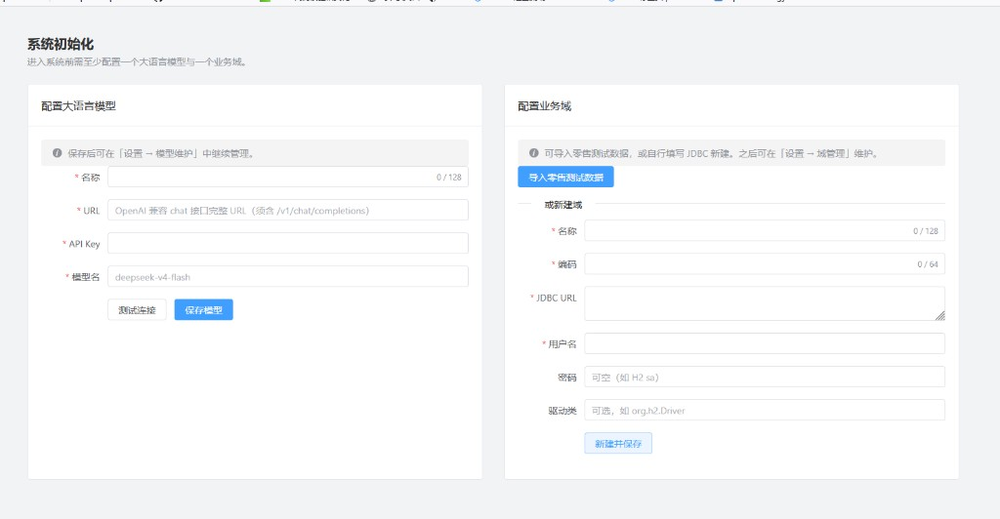

# 快速开始

本文帮助你尽快把 OpenOntology **跑起来并用起来**。更完整的目录、停机、换库、Skills 等见 [安装手册](install.md)。

假设你已从 GitHub Release 下载并解压发行包，解压后的目录下文称为 `SERVER_HOME`。

> **说明**：下文步骤以 **Windows** 为例。Linux / macOS 流程相同——安装 JDK 25+、配置 `JAVA_HOME`、执行 `bin/startup.sh` 后打开浏览器即可；细节可参考 [安装手册](install.md)。

## 1. 安装 JDK 25（Windows）

本系统需要 **JDK 25 或更高**（不是仅含运行环境的旧版 JRE）。

下文以 **Oracle JDK 25** 为安装示例；**OpenJDK 发行版**（如 Eclipse Temurin、Microsoft Build of OpenJDK 等）同样可用，只要 `java -version` 主版本 ≥ 25。

1. 打开 Oracle JDK 下载页：[https://www.oracle.com/java/technologies/downloads/](https://www.oracle.com/java/technologies/downloads/)（选择 **JDK 25**、Windows）  
2. 下载并运行安装包（`.msi` / `.exe` 均可，按向导完成）  
3. 记下安装目录（常见类似 `C:\Program Files\Java\jdk-25`，其下应有 `bin\java.exe`）  
4. **新开**命令提示符或 PowerShell，执行：

```bat
java -version
```

输出中应能看到版本 **25**（或更高）。若提示不是内部命令，说明尚未加入 `PATH`，请继续下一节配置 `JAVA_HOME`。

> 若机器上已有多个 Java，务必保证启动本产品时用的是 25+（由下一节 `JAVA_HOME` 决定）。

## 2. 配置 JAVA_HOME（Windows）

任选一种方式即可。

### 方式 A：系统环境变量（推荐）

1. 右键「此电脑」→「属性」→「高级系统设置」→「环境变量」  
2. 新建用户或系统变量：  
   - 变量名：`JAVA_HOME`  
   - 变量值：JDK 安装目录（例如 `C:\Program Files\Java\jdk-25`，目录下应有 `bin\java.exe`）  
3. 编辑 `Path`，加入 `%JAVA_HOME%\bin`（若尚未包含）  
4. **关闭并重新打开**终端，执行：

```bat
echo %JAVA_HOME%
java -version
```

### 方式 B：只在启动脚本里指定（不改系统环境）

编辑 `SERVER_HOME\bin\server.bat`，找到类似下面的注释行，去掉 `rem` 并改成你的 JDK 路径：

```bat
rem set JAVA_HOME=D:\java\jdk-25
```

改为例如：

```bat
set JAVA_HOME=C:\Program Files\Java\jdk-25
```

## 3. 启动服务（Windows）

在 `SERVER_HOME` 下执行：

```bat
bin\startup.bat
```

启动成功后，用支持 **HTML5** 的浏览器打开：

```text
http://localhost:8825/
```

（端口以 `conf/ontology.json` 中 `http.port` 为准，缺省 8825。）

## 4. 系统初始化（首次必做）

首次进入会跳到 **系统初始化** 页（`/init`）：进入系统前需至少配置 **一个大语言模型** 与 **一个业务域**。



### 4.1 左侧：配置大语言模型（以 DeepSeek 为例）

1. **名称**：随意，例如 `deepseek`  
2. **URL**：须为 OpenAI 兼容的 **完整** chat 接口地址，且路径含 `/v1/chat/completions`  
   - DeepSeek 示例：`https://api.deepseek.com/v1/chat/completions`  
3. **API Key**：在 DeepSeek 开放平台申请（见下节）  
4. **模型名**：例如 `deepseek-v4-flash`（以平台当前可用模型名为准）  
5. 先点 **测试连接**，成功后再点 **保存模型**  

保存后也可在「设置 → 模型维护」中继续管理。

### 4.2 如何申请 DeepSeek API Key

这里申请的是 **调用大模型的 API 密钥**（不是软件 License）。

1. 打开 DeepSeek 开放平台：[https://platform.deepseek.com](https://platform.deepseek.com)（以官网实际入口为准）  
2. 注册 / 登录账号  
3. 进入 API Key（密钥）管理页，**创建新密钥**  
4. 复制密钥（通常只显示一次），粘贴到初始化页的 **API Key**  
5. 按平台说明完成充值或免费额度配置（若需要）  

官方说明还可参考：[DeepSeek API 文档](https://api-docs.deepseek.com/)。

其它兼容 OpenAI Chat Completions 的模型供应商，同样填写「完整 URL + API Key + 模型名」即可。

### 4.3 右侧：配置业务域

任选其一：

- **导入零售测试数据**（推荐）：一键安装演示域，便于马上在智能体工作台里试问  
- **或新建域**：自行填写名称、编码与 JDBC（可接已有库；密码等可按提示留空，如 H2）

完成后即可离开初始化页进入系统。

## 5. 开始使用

1. 顶栏确认已选中业务**域**  
2. 打开 **智能体工作台**  
3. 用业务语言提问，例如：「哪些客户卖的比较好，为什么？」

## 下一步

- 目录结构、停止服务、切换其它数据库、外部 Skills 等：[安装手册](install.md)  
- 若要使用**算法训练/推理**或依赖 bash 的技能执行，需额外安装 Python 与 bash，见 [安装手册 · Python 与 bash](install.md#python-bash)  
- 产品说明与亮点：[README](../README.md)
